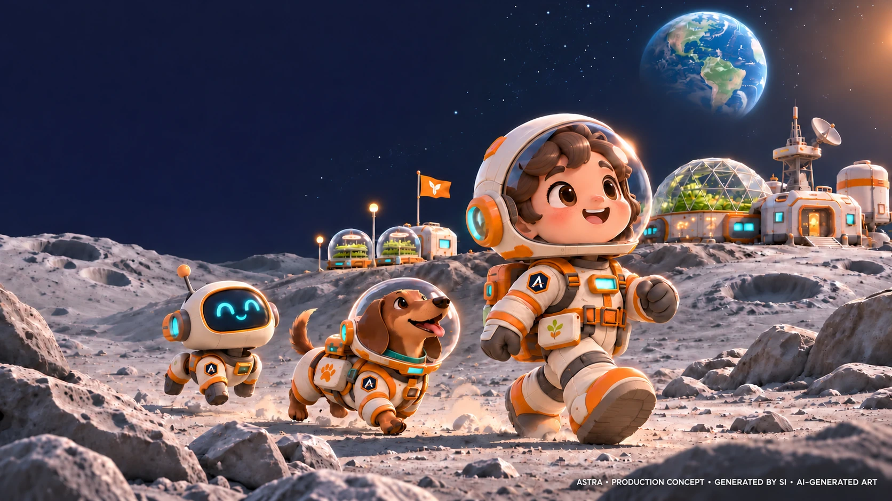
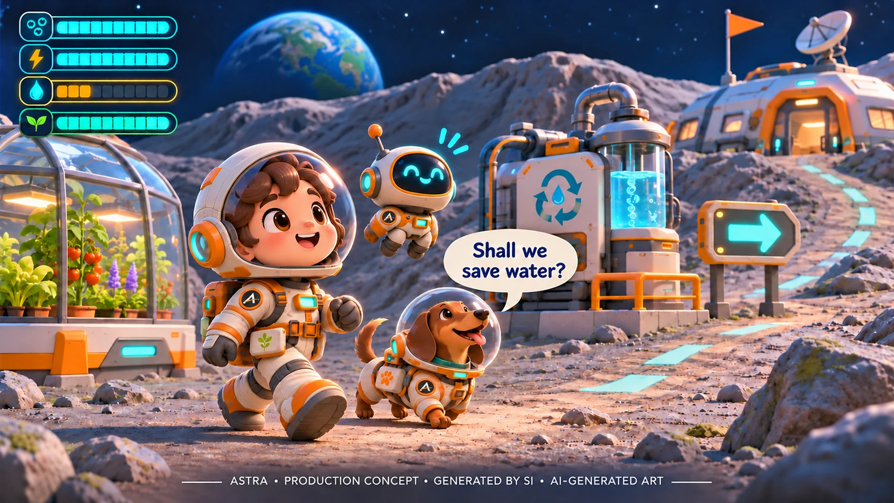
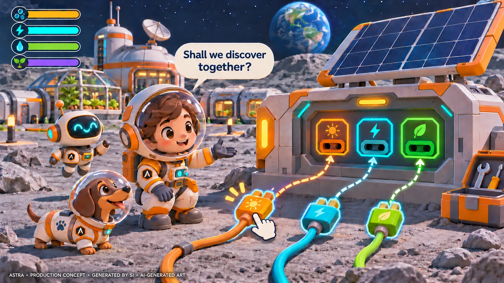
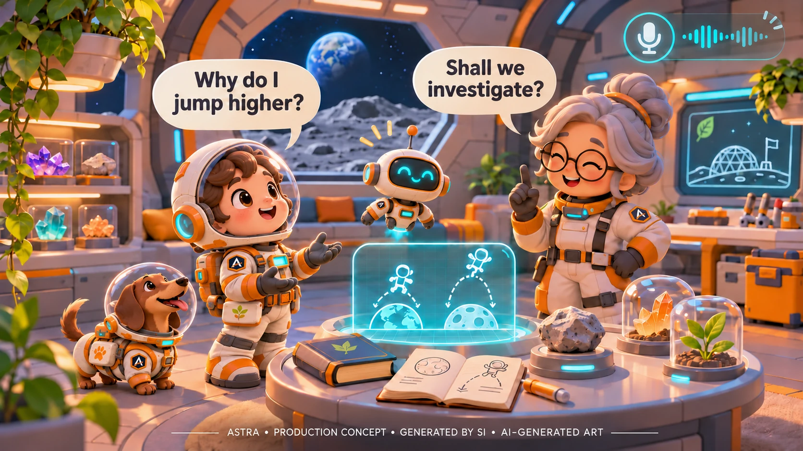

<p align="center">
  <picture>
    <source media="(prefers-color-scheme: dark)" srcset="docs/readme/astra-lockup-dark.svg">
    
  </picture>
</p>

# ASTRA — Junior Astronaut Mission Trainer

**A child becomes the astronaut.**

ASTRA is a browser-based space adventure that connects exploration, companionship and scientific decisions. A young astronaut trains on Earth, travels to a fictional lunar outpost and discovers what it takes to keep a base alive. The intended production audience is children aged 7–12, with a supervised educator pilot planned to evaluate the experience.

<p align="center">
  <a href="https://astra-junior-mission-trainer.vercel.app/"><strong>Play the demo ↗</strong></a>
  &nbsp; · &nbsp;
  <a href="https://astra-institutional.vercel.app/"><strong>Explore the institutional website ↗</strong></a>
</p>



*Production vision · Generated by SI · AI-generated art. The original ASTRA logo above is also AI-generated vector artwork.*

## The idea

> A partner by your side. A universe to discover.

Space is a system, and learning can be an adventure. A lunar base needs power, water, oxygen, food and protection from radiation. ASTRA gives the child a reason to notice those connections: investigate a problem, make a choice, act in the world and see what changes.

The child leads the mission. PIP provides guidance, while a companion brings continuity and personality to the journey. Short conversations, visible resource bars and meaningful tasks keep attention on exploration and decisions. The production vision puts the child's own stylized astronaut identity and chosen buddy at the center of the experience.

The learning loop is **observe → investigate → decide → act → measure → reflect**. Our next step is to test whether learners can explain a trade-off and apply their discovery to a different challenge.

## A mission of connected choices

| System | What the astronaut investigates |
| --- | --- |
| **Power and energy** | Repair generation and connections, store energy and prioritize equipment. |
| **Life support** | Connect electricity, water recycling and oxygen production. |
| **Radiation and shelter** | Recognize a warning, interrupt outside work and seek protection. |
| **Plants and food** | Balance irrigation, power and growing time against other needs. |



*Production vision · Generated by SI · AI-generated art. This illustration shows the intended visual direction; the playable prototype has its own simpler 3D assets and interface.*

## What you can explore today

The public demo is an independent **Babylon.js** prototype. It runs without an account or API key; saves and checkpoints stay in the player's browser. Much of the current game interface and narrative is in Portuguese.

- **Train and travel:** visit the Earth academy, prepare cargo and reach the lunar base through an assisted orbital sequence.
- **Repair and operate:** investigate equipment and manage linked power, water and oxygen supplies.
- **Explore and investigate:** prepare a field loadout, inspect discoveries and bring a finite ice sample back for processing.
- **Care for the base:** supply the greenhouse and take shelter during a fictional radiation event.
- **Travel with company:** encounter PIP and the optional astronaut dachshund Cometa, with authored offline interactions and reminders.

Five finite authored regions, animated character assets, graphical resource indicators, a journal and deterministic resource accounting are present in the source. The orbital controller is floor-assisted. The terrain, storm and engineering rates are didactic game abstractions.

## The world we want to build

The production vision expands the prototype into a personal space adventure:

- **Your astronaut, your companion.** An original ASTRA-style avatar inspired by a chosen photo, and a customizable human, dog, cat, turtle or robot buddy.
- **Conversations inside the adventure.** Short dialogue bubbles, optional voice interaction and source-grounded explanations from PIP and the companion.
- **Hands-on discoveries.** Playful equipment tasks, museum exhibits and science terminals that connect an action to its explanation.
- **A place to call home.** A customizable base and wearable knowledge badges that recognize demonstrated discoveries.
- **A supervised path forward.** Planned guardian settings, educator progress views and later cooperative play, with privacy and age-appropriate interaction designed into those services.

These are **planned production features**, distinct from the current demo. Photo generation, microphone conversations, an AI tutor, guardian services and multiplayer are not implemented services in this prototype. Today, companion dialogue is authored and works offline.

<table>
  <tr>
    <td width="50%"></td>
    <td width="50%"></td>
  </tr>
  <tr>
    <td><strong>Small tasks. Meaningful consequences.</strong><br>Production concept · Generated by SI · AI-generated art.</td>
    <td><strong>A little help. A lot of agency.</strong><br>Production concept · Generated by SI · AI-generated art.</td>
  </tr>
</table>

## Technical foundation

| Layer | Current implementation |
| --- | --- |
| Language and interface | TypeScript 5.9.3, HTML and CSS |
| 3D engine | Babylon.js 9.35.0 core and glTF/GLB loaders |
| Build and runtime | Vite 7.3.8, Node.js 24 and npm; static web deployment |
| Game rules | Pure deterministic fixed-tick simulation, explicit units and ordered actions |
| World and characters | Finite authored regions, local GLB models, animation clips and companion state machines |
| Persistence | Versioned browser-local saves and checkpoints |
| Verification | Vitest 4.1.12, asset/provenance audits and a Chromium browser-check runner |

Babylon renders the world; the simulation owns resource truth. Dialogue, companion behavior and animations cannot create resources outside that accounting. Core gameplay has no external AI or live-data dependency.

## Run locally

Use **Node.js 24** and a browser with **WebGL 2** support.

```sh
git clone https://github.com/andrecodexvictor/astra-junior-astronaut-mission-trainer.git
cd astra-junior-astronaut-mission-trainer
npm ci
npm run dev
```

Open the URL printed by Vite. `npm run build` creates the static `dist/` directory.

| Controls | Action |
| --- | --- |
| WASD / arrow keys | Move |
| Mouse drag | Rotate the camera |
| Shift / Space / E | Run / jump / interact |
| Tab / J / M | Objectives / science journal / map |
| Esc | Pause |

## Verification and science

```sh
npm run check
npm run test:e2e
```

The recorded baseline includes **67 CPU tests** and **16 staged Chromium/SwiftShader visual checks**. Full-route browser acceptance, physical-GPU performance and evaluation with learners remain pending. These technical checks do not establish learning outcomes. See [the test report](TEST_REPORT.md) and [acceptance record](ACCEPTANCE.json) for the exact scope and tested revisions.

NASA references inform lunar gravity, life support, radiation and plant-growth concepts. A genuine NASA Blue Marble image is packaged as the Earth texture. The project currently uses static references rather than a live NASA feed, and its lunar terrain is fictional. See [science assumptions](docs/demo/SCIENCE_ASSUMPTIONS.md), [NASA data and usage](docs/delivery/NASA_DATA_AND_USAGE_EN.md) and the [source registry](public/science/nasa-data-registry.json).

## Credits and provenance

ASTRA is an independent project inspired by the Junior Astronaut Mission Trainer challenge. NASA does not endorse the project. Existing work and its real version history are preserved in [prior-work notes](docs/PRIOR_WORK.md).

The illustrations and logo in this README are the same approved assets used by the institutional website, copied without cropping, recoloring or character regeneration. They are visibly identified as **Generated by SI · AI-generated art** and depict production concepts. NASA satellite imagery is separately credited and is not AI-generated. Exact source revisions and hashes are in the [README asset inventory](docs/readme/ASSET_PROVENANCE.json); [AI usage](AI_USAGE.md) documents the broader assistance and limitations.

Original code contributions are licensed under [Apache-2.0](LICENSE). Third-party assets and notices retain their applicable terms; see [NOTICE](NOTICE).
