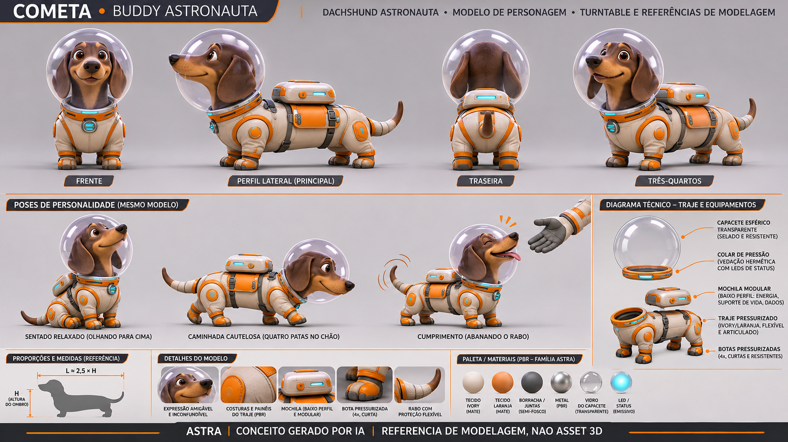
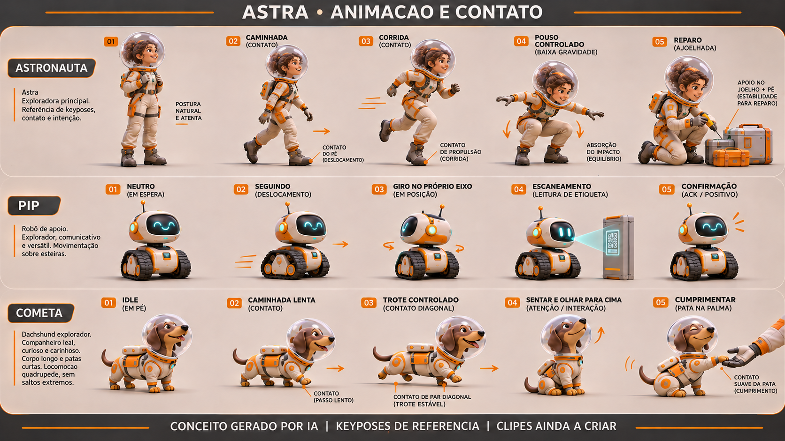
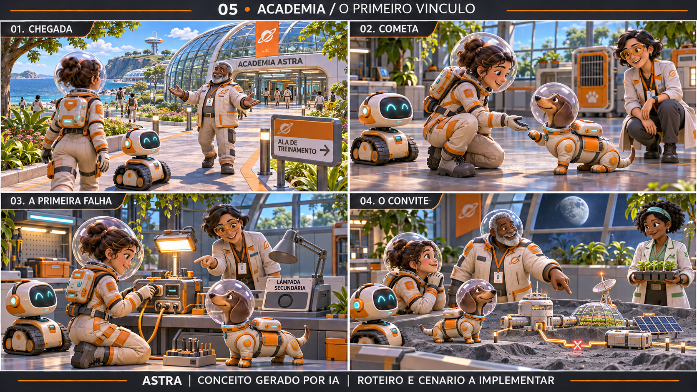
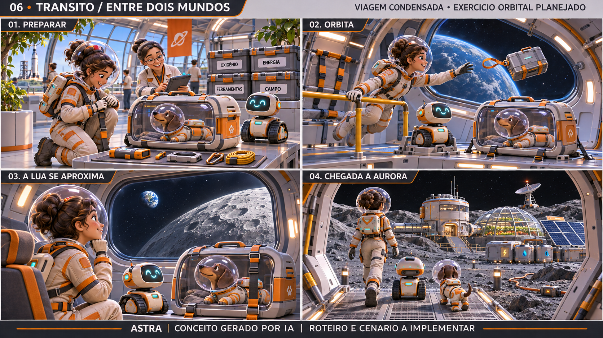
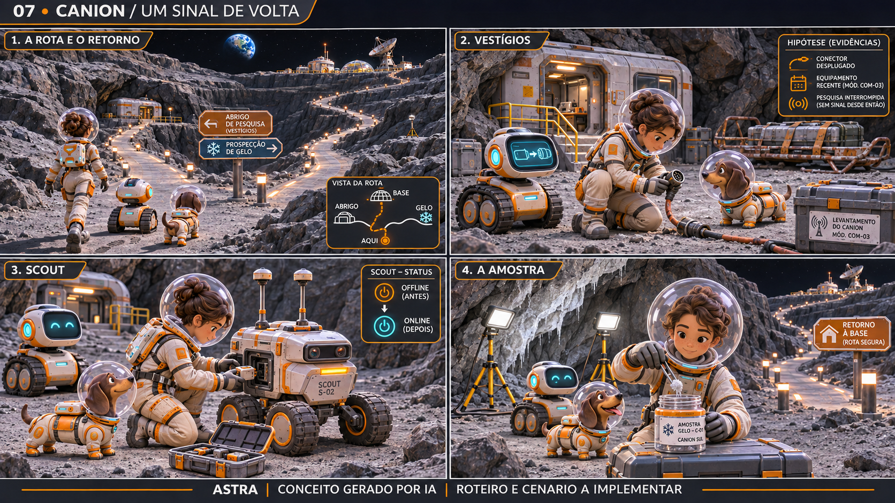
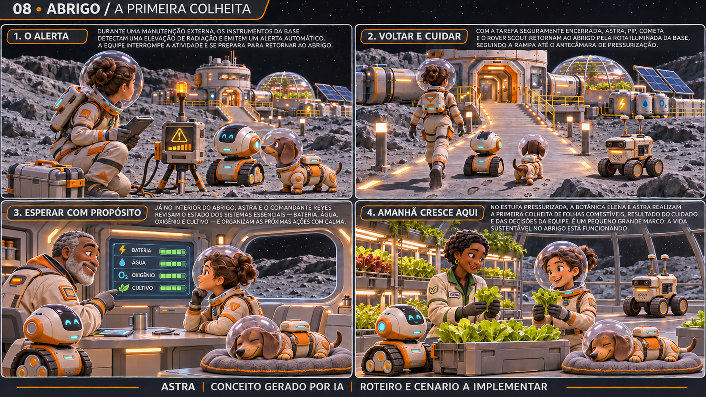

# ASTRA — referências visuais para implementar no Babylon.js

Criadas em 14/11/2026 a pedido do proprietário. Oito imagens originais geradas por IA, com identificação visível. São **metas de arte e modelagem**, não capturas do jogo publicado, modelos 3D ou clipes de animação. Os PNGs estão no clone para o Gemini abrir diretamente; títulos e números abaixo são os IDs do pacote.

Antes de aumentar o mundo, abrir as oito imagens com uma ferramenta de visão, ler [a tradução para Babylon](ART_TO_BABYLON.md), [a pesquisa](../research/HORIZON_NMS_WORLDBUILDING.md) e a [spec de animação](../animation/CHARACTER_ANIMATION_SPEC.md). Se a ferramenta não puder ver PNGs, declarar o limite e usar o texto técnico; não afirmar revisão visual inexistente. Depois implementar um incremento e comparar uma captura real com a prancha, mantendo controles e simulação funcionais.

## 01 — Atlas de quatro ambientes

**Extrair:** família de materiais, equipamento modular, diferença Terra/Lua, escala acolhedora dos personagens, caminhos legíveis e espaços seguros de conversa. Os setores correspondem a regiões já existentes na demo, a refinar; a academia ilustrada não prova que piscina/campus já foram modelados.

**Interpretar com cuidado:** as pranchas lunares foram corrigidas para gelo discreto/reflexivo, iluminado por refletores, sem cristal mágico emissivo. A prancha 02 governa a composição principal. A distribuição é ficcional; não é um depósito medido. Uniformizar capacetes/vedação/escala no asset final, mesmo quando o desenho conceitual simplificar algum detalhe.

## 02 — Aurora: vista principal de exploração

**Extrair:** personagem de costas como escala, robô e cachorro visíveis, três camadas de profundidade, antena como marco, abrigo acolhedor, estufa confinada, bifurcação e rota de retorno. O croqui é referência de conexões; o mapa jogável deve vir do estado real. Rampa e eclusa precisam funcionar para humano e quadrúpede. Construir o relevo com malha e colisão coerentes; não usar esta imagem como fundo para fingir um mundo navegável.

**Não inferir:** cidade infinita, fidelidade topográfica NASA, rover já implementado, abrigo com dose validada ou qualidade gráfica já atingida. O trenó/equipamentos são sugestões de narrativa ambiental, não entregas executáveis.

## 03 — Cometa, salsichinha astronauta

**Extrair:** dachshund real, corpo comprido, patas curtas, focinho alongado e orelhas caídas dentro do capacete transparente. Traje branco/laranja de quatro patas, botas, mochila baixa e proteção da cauda. Cometa é nome provisório. Esta prancha prevalece sobre proporções menos consistentes nas cenas amplas. As vistas são referências desenhadas, não projeções CAD com medidas garantidas.

**Entregar depois:** modelo local original com rig quadrúpede, pesos e clips, conforme [Cometa](../characters/COMETA_BUDDY.md) e [animação](../animation/CHARACTER_ANIMATION_SPEC.md). O buddy não está no runtime atual. O traje e a presença do animal são ficção de gameplay, sem alegação de missão ou traje real da NASA.

## 04 — Contato e intenção de movimento

**Extrair:** idle/caminhada/corrida/pouso/reparo humanos, deslocamento mecânico de PIP e contato quadrúpede de Cometa. A prancha corrigida mantém capacetes humanos fechados. Os desenhos comunicam intenção; não são frames consecutivos, animação exportada ou prova de fase correta de patas. O rig real precisa validar suporte e contato em todos os frames intermediários.

Astronauta, NPC humano, PIP, Scout e Cometa têm listas distintas de clips. Usar o manifesto proposto em [animation-manifest.json](../../content-design/animation-manifest.json), sem tratar os nomes planejados como clips presentes nos GLBs atuais. A máquina de animação não controla posição, consumo ou conclusão de reparo.

## Verificação e uso

[manifest.json](manifest.json) registra dimensões, hashes e proveniência. Os PNGs foram copiados sem alterar os arquivos gerados. Nenhuma screenshot de Horizon ou No Man’s Sky foi redistribuída. Os links oficiais da pesquisa servem como referência externa. As contribuições originais seguem a licença do projeto; materiais externos mantêm seus direitos. Não remover os rótulos de IA nem apresentar os conceitos como gameplay.

Executar `npm run audit:art`. O verificador confere integridade e metadados; não mede qualidade artística nem verifica animação/GPU.

## 05 — Academia: o primeiro vínculo

**Função no mundo/roteiro:** apresentar um lugar seguro e uma equipe antes da crise. Caminho até o laboratório, aproximação de Cometa, leitura e redução de carga, convite para Aurora. Reyes estabelece propósito; Lia oferece pista; Elena apresenta o cultivo como algo a proteger. As aparências humanas são propostas; a protagonista ilustrada é uma opção de avatar.

**Converter em jogo:** 1–2 falas opcionais por encontro, controle devolvido rapidamente, interação no equipamento e medida real de bateria. A amizade não concede recursos. Campus ampliado, gestos e cena de Cometa ainda exigem modelagem/animação. O modelo da base no briefing é um prop, não um segundo mundo simulado.

## 06 — Trânsito: entre dois mundos

**Função no mundo/roteiro:** tornar a mudança Terra→Lua compreensível e emocional. Preparação visível, objeto a recuperar, breve contemplação e primeira vista de uma base parcialmente operacional. Cometa viaja acomodado; PIP mantém seu papel de apoio.

**Converter em jogo:** preparar carga com limites quando esse sistema existir; respeitar o gate atual de recuperar carga antes da descida. O quadro de flutuação é uma evolução visual/funcional proposta: a cabine atual ainda é assistida e não demonstra 6DoF. Viagem e distâncias são condensadas; as janelas não são uma representação orbital medida.

## 07 — Cânion: um sinal de volta

**Função no mundo/roteiro:** transformar a saída em investigação com uma volta útil. Um marco permite localizar a base; abrigo de pesquisa e cabo dão contexto; Scout cria vínculo por reparo; gelo vira uma amostra que precisa voltar para ser processada. A inscrição de uma caixa é pista ficcional, não prova automática de uma causa.

**Converter em jogo:** preservar `survey-beacon`, `damaged-scout`, `ice-deposit` e `return-gate`, ou migrar IDs explicitamente. O Scout de quatro rodas/duas antenas é direção de modelo futuro, não o GLB atual já substituído. Painéis/mapa desenhados são anotações conceituais; o HUD deve ler o mundo e a simulação. Gelo não é cristal emissivo e a localização continua ficcional.

## 08 — Abrigo: a primeira colheita

**Função no mundo/roteiro:** mostrar a consequência de interromper trabalho, cuidar da equipe e proteger a continuidade do habitat. O céu não muda para uma tempestade terrestre: o risco é comunicado por instrumentos. A espera cria um respiro com Reyes; a estufa oferece uma conquista pequena e concreta com Elena, PIP, Scout e Cometa.

**Converter em jogo:** estado do alerta, custo/tempo, abrigo, crescimento e reservas vêm da simulação. Barras verdes ilustradas não são valores para hardcode; colheita exige tempo e condições reais. Scout mantém o desenho de robô de pesquisa, distinto de PIP e de um trenó. Cometa pode descansar sem bloquear a missão. Não mostrar dano ao animal ou transformar radiação em nuvens/relâmpagos.

## Ler o episódio completo

O tratamento [Uma luz de cada vez](../narrative/EPISODE_01_TREATMENT.md) organiza dez batidas com falas originais, alvo de mundo, ação, evidência, escolhas e retry. [narrative-beats.json](../../content-design/narrative-beats.json) é um contrato proposto para a implementação, não uma quest já executável. Usar os storyboards como beats de ritmo, sem impor sua ordem quando a simulação exigir abrigo, recurso ou retorno mais cedo.
