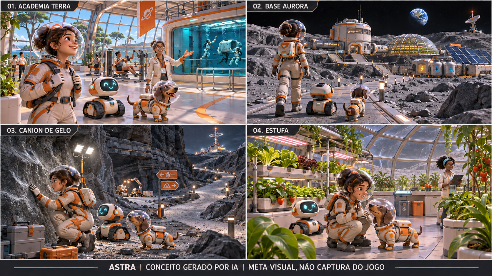
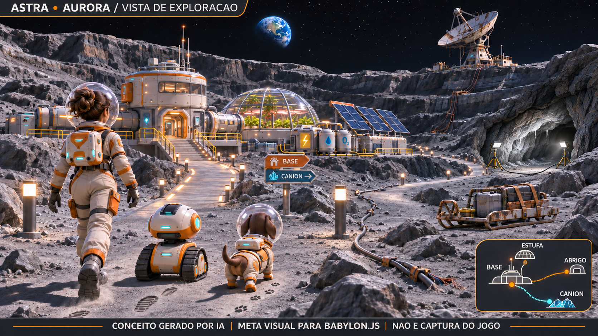

# ASTRA — referências visuais para implementar no Babylon.js

Criadas em 14/11/2026 a pedido do proprietário. Quatro imagens originais geradas por IA, com identificação visível. São **metas de arte e modelagem**, não capturas do jogo publicado, modelos 3D ou clipes de animação. Os PNGs estão no clone para o Gemini abrir diretamente; títulos e números abaixo são os IDs do pacote.

Antes de aumentar o mundo, abrir as quatro imagens com uma ferramenta de visão, ler [a tradução para Babylon](ART_TO_BABYLON.md), [a pesquisa](../research/HORIZON_NMS_WORLDBUILDING.md) e a [spec de animação](../animation/CHARACTER_ANIMATION_SPEC.md). Se a ferramenta não puder ver PNGs, declarar o limite e usar o texto técnico; não afirmar revisão visual inexistente. Depois implementar um incremento e comparar uma captura real com a prancha, mantendo controles e simulação funcionais.

## 01 — Atlas de quatro ambientes

**Extrair:** família de materiais, equipamento modular, diferença Terra/Lua, escala acolhedora dos personagens, caminhos legíveis e espaços seguros de conversa. Os setores correspondem a regiões já existentes na demo, a refinar; a academia ilustrada não prova que piscina/campus já foram modelados.

**Interpretar com cuidado:** as pranchas lunares foram corrigidas para gelo discreto/reflexivo, iluminado por refletores, sem cristal mágico emissivo. A prancha 02 governa a composição principal. A distribuição é ficcional; não é um depósito medido. Uniformizar capacetes/vedação/escala no asset final, mesmo quando o desenho conceitual simplificar algum detalhe.

## 02 — Aurora: vista principal de exploração

**Extrair:** personagem de costas como escala, robô e cachorro visíveis, três camadas de profundidade, antena como marco, abrigo acolhedor, estufa confinada, bifurcação e rota de retorno. O croqui é referência de conexões; o mapa jogável deve vir do estado real. Rampa e eclusa precisam funcionar para humano e quadrúpede. Construir o relevo com malha e colisão coerentes; não usar esta imagem como fundo para fingir um mundo navegável.

**Não inferir:** cidade infinita, fidelidade topográfica NASA, rover já implementado, abrigo com dose validada ou qualidade gráfica já atingida. O trenó/equipamentos são sugestões de narrativa ambiental, não entregas executáveis.

## 03 — Cometa, salsichinha astronauta

**Extrair:** dachshund real, corpo comprido, patas curtas, focinho alongado e orelhas caídas dentro do capacete transparente. Traje branco/laranja de quatro patas, botas, mochila baixa e proteção da cauda. Cometa é nome provisório. Esta prancha prevalece sobre proporções menos consistentes nas cenas amplas. As vistas são referências desenhadas, não projeções CAD com medidas garantidas.

**Entregar depois:** modelo local original com rig quadrúpede, pesos e clips, conforme [Cometa](../characters/COMETA_BUDDY.md) e [animação](../animation/CHARACTER_ANIMATION_SPEC.md). O buddy não está no runtime atual. O traje e a presença do animal são ficção de gameplay, sem alegação de missão ou traje real da NASA.

## 04 — Contato e intenção de movimento

**Extrair:** idle/caminhada/corrida/pouso/reparo humanos, deslocamento mecânico de PIP e contato quadrúpede de Cometa. A prancha corrigida mantém capacetes humanos fechados. Os desenhos comunicam intenção; não são frames consecutivos, animação exportada ou prova de fase correta de patas. O rig real precisa validar suporte e contato em todos os frames intermediários.

Astronauta, NPC humano, PIP, Scout e Cometa têm listas distintas de clips. Usar o manifesto proposto em [animation-manifest.json](../../content-design/animation-manifest.json), sem tratar os nomes planejados como clips presentes nos GLBs atuais. A máquina de animação não controla posição, consumo ou conclusão de reparo.

## Verificação e uso

[manifest.json](manifest.json) registra dimensões, hashes e proveniência. Os PNGs foram copiados sem alterar os arquivos gerados. Nenhuma screenshot de Horizon ou No Man’s Sky foi redistribuída. Os links oficiais da pesquisa servem como referência externa. As contribuições originais seguem a licença do projeto; materiais externos mantêm seus direitos. Não remover os rótulos de IA nem apresentar os conceitos como gameplay.

Executar `npm run audit:art`. O verificador confere integridade e metadados; não mede qualidade artística nem verifica animação/GPU.
